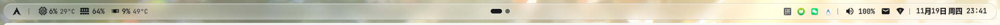
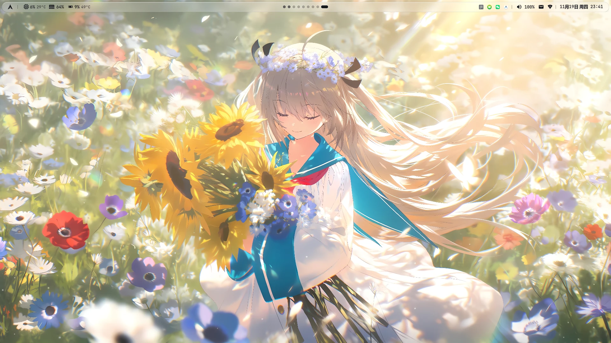
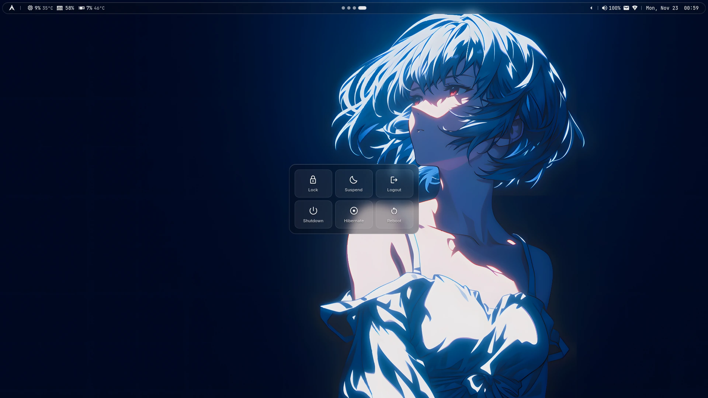
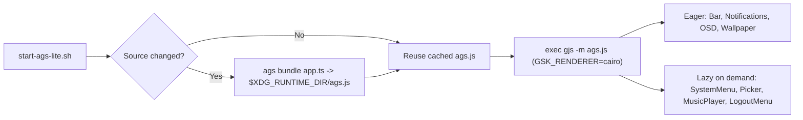

<div align="center">

# Taskbar

**A lightweight, adaptive GTK4 status bar & desktop shell for Hyprland**  
Built with TypeScript, [AGS / Astal](https://github.com/Aylur/astal), GJS (Cairo), SCSS, and [Matugen](https://github.com/InioX/matugen)

<p>
  
  
  
  
</p>

<p>
  
  
  <a href="LICENSE"></a>
</p>

<br />



<sub>Floating adaptive frosted-glass bar — Arch logo, CPU/RAM/GPU telemetry, sequential workspace dots, system tray, volume, notifications, network/BT, and localized clock</sub>

</div>

---

## Showcase

<table>
  <tr>
    <td align="center" width="50%">
      
      <br />
      <sub><b>Desktop &amp; Workspace Pill</b> — Matugen auto-contrasted ink over bright wallpaper</sub>
    </td>
    <td align="center" width="50%">
      
      <br />
      <sub><b>Session &amp; Power Overlay</b> — Lazy-mounted frosted-glass modal</sub>
    </td>
  </tr>
</table>

---

## Highlights

| Area | Details |
| :--- | :--- |
| **Top Bar Modules** | OS launcher button, hardware telemetry (`CPU % / °C`, `RAM %`, `GPU % / °C`), sequential Hyprland workspace pill, `AstalTray`, volume control, notification badge (click center / right-click DND), Wi-Fi &amp; Bluetooth indicators, and minute-aligned clock with revealable power trigger. |
| **Adaptive Matugen Glass** | Automatic light/dark ink selection (`_wallpaper-contrast.scss`, `_glass.scss`) over static, video, or Wallpaper Engine backdrops, with non-flickering CSS hot-reload. |
| **Lazy Popup Windows** | Heavy overlays (`system-menu`, `music-player`, `picker`, `logout-menu`) and wallpaper directory indexing are deferred via [`utils/popups.ts`](utils/popups.ts) until first invocation. |
| **Low-Memory Runtime** | [`start-ags-lite.sh`](start-ags-lite.sh) caches the compiled JS bundle in `$XDG_RUNTIME_DIR/ags.js`, executes `gjs -m` directly (no Go wrapper), and forces `GSK_RENDERER=cairo` so GTK4 skips per-process GL/Vulkan shader heaps. |

---

## Memory Optimization Profile

Measured on Arch Linux (`Hyprland` / `DP-1` 1920×1080) via `/proc/<pid>/smaps_rollup`:

| Stage | Processes | Total PSS | Total RSS | Key Changes |
| :--- | :--- | ---: | ---: | :--- |
| **Baseline (`ags run`)** | `ags` + `gjs` + `astal-notifd` | `266.31 MiB` | `357.36 MiB` | Persistent Go wrapper + GTK4 GL renderer + GPU `/dev/nvidiactl` &amp; LLVM mappings + startup Sass |
| **Lite Launcher + Cairo** | `gjs` + `astal-notifd` | `128.36 MiB` | `190.77 MiB` | Eliminated `ags run`, enabled `GSK_RENDERER=cairo`, cached `main.css`, fixed ESM `System.gc()`, capped thumbnail cache (`12`) |
| **Legacy Trim + Lazy Popups** | `gjs` + `astal-notifd` | **`119.68 MiB`** | **`185.20 MiB`** | Removed unused `sidebar` / `weather` / `screencorners` / `river`; lazy-mounted all 4 popup windows &amp; `utils/picker` |



---

## Quick Start

```bash
git clone https://github.com/b53v/taskbar.git ~/.config/ags
chmod +x ~/.config/ags/start-ags-lite.sh
~/.config/ags/start-ags-lite.sh
```

Add to Hyprland startup (`Startup_Apps.conf`):

```ini
exec-once = $HOME/.config/ags/start-ags-lite.sh
```

<details>
<summary><b>IPC Commands (<code>ags request -i taskbar ...</code>)</b></summary>

```bash
ags list
ags request -i taskbar picker          # Toggle app / clipboard / wallpaper picker
ags request -i taskbar system-menu     # Toggle quick settings & notification center
ags request -i taskbar music-player    # Toggle MPRIS media player popup
ags request -i taskbar logout          # Toggle session / power overlay
ags request -i taskbar reload-css      # Recompile style/main.scss & apply live
ags request -i taskbar wall-rand       # Pick a random wallpaper (lazy-loads picker)
ags request -i taskbar gc              # Trigger GJS System.gc()
```

</details>

<details>
<summary><b>Project Layout &amp; Regression Tests</b></summary>

```text
.
├── app.ts                  # Entry point (instanceName: "taskbar"), IPC & GC timers
├── options.ts              # Persistent & cached option definitions
├── start-ags-lite.sh       # Incremental bundler + Cairo gjs -m launcher
├── widgets/
│   ├── bar/                # Status bar & modules (Workspaces, Hardware, SysTray, Volume, Time...)
│   ├── picker/             # App, clipboard & wallpaper picker (lazy-loaded)
│   ├── system-menu/        # Quick toggles, sliders & notification center (lazy-loaded)
│   ├── music/              # MPRIS player popup with blurred album backdrop (lazy-loaded)
│   ├── logout-menu/        # Power & session overlay (lazy-loaded)
│   ├── notifications/      # Live notification toasts
│   ├── osd/                # Volume / brightness / mic OSD
│   └── wallpaper/          # Native layer-shell video wallpaper
├── utils/                  # popups.ts, compositor, sysmon, notifd, wallpaper, wifi, bluetooth
├── style/                  # Modular SCSS + prebuilt main.css
├── matugen/                # Matugen templates for GTK, AGS SCSS, Hyprland, Hyprlock
└── tests/                  # Regression & wallpaper contrast test suites
```

Run local verification suites inside a Hyprland session:

```bash
python tests/run-regressions.py
python tests/wallpaper-contrast.py
```

</details>
